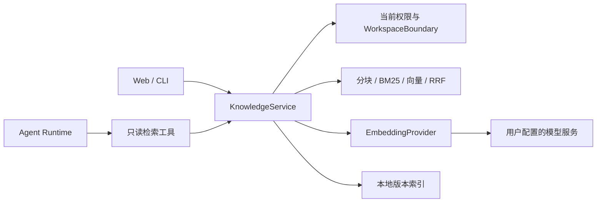

# 仓库知识检索增强（RAG）Plan

状态：已批准
日期：2026-10-24
依据：[spec.md](spec.md)（已批准）

用户于 2026-10-24 指示开始开发，四份文档作为本轮批准基线；实现偏差按变更控制处理。

## 架构概览

Web/CLI 调用共享 KnowledgeService 管理索引；Agent 通过只读工具调用同一查询服务。核心检索算法只依赖领域类型，模型适配负责 Embedding，运行时负责授权扫描、版本存储和生命周期。页面不包含检索算法，核心不导入运行时或 React。



## 需求映射

| 需求 | 负责模块/交互 | 设计说明 |
| --- | --- | --- |
| F1 | SettingsService、knowledge/config、两端设置 | 独立服务配置、工作区启用与范围、公开视图脱敏 |
| F2 | scanner、chunker、indexer | 安全扫描、结构分块、跳过报告 |
| F3 | store、lifecycle、indexer | 增量复用、跨进程互斥、完整版本发布 |
| F4 | tokenizer、ranking、service | 双路召回、融合、过滤、预算 |
| F5 | access、service、工具结果 | 返回前权限与哈希核对、来源定位 |
| F6 | search-knowledge、AgentRuntime、tool-use | 按需调用、模式兼容、上下文复用 |
| F7 | embedding-provider、lifecycle、service | 错误分类、降级、取消与预算 |
| F8 | knowledge HTTP 适配、CLI 命令、设置组件 | 最小管理、状态轮询和来源显示 |
| F9 | 固定问题集、评估脚本与报告 | 检索及 Agent 对照、失败与成本记录 |

## 核心类型与接口

```ts
type KnowledgeScope = "docs" | "code" | "tests" | "all";
type KnowledgeErrorCode =
  | "disabled" | "not-indexed" | "invalid-arguments" | "permission-denied"
  | "incompatible" | "corrupt-index" | "provider-unavailable"
  | "timeout" | "cancelled" | "limit-exceeded" | "busy" | "storage";
type KnowledgeFailure = {
  kind: "failure";
  code: KnowledgeErrorCode;
  retryable: boolean;
  nextAction: "configure" | "build" | "refresh" | "retry" | "use-file-tools" | "none";
};
type KnowledgeHit = {
  path: string;
  startLine: number;
  endLine: number;
  excerpt: string;
  label?: string;
  contentHash: string;
  indexVersion: string;
  historical: boolean;
  matchedBy: readonly ("keyword" | "semantic")[];
};
type KnowledgeSearchResult = KnowledgeFailure | {
  kind: "results";
  outcome: "matches" | "no-match" | "partial";
  retrieval: "hybrid" | "keyword-fallback";
  indexVersion: string;
  hits: readonly KnowledgeHit[];
  omitted: number;
  staleCount: number;
  degradedReason?: "provider-unavailable" | "semantic-budget-exhausted";
};
type EmbeddingResult = {
  vectors: readonly (readonly number[])[];
  usage: { kind: "reported"; inputTokens: number } | { kind: "unknown" };
};
interface EmbeddingProvider {
  embed(texts: readonly string[], signal: AbortSignal): Promise<EmbeddingResult>;
}
interface KnowledgeReader {
  search(input: { query: string; scope: KnowledgeScope; limit: number },
    signal: AbortSignal): Promise<KnowledgeSearchResult>;
}
type IndexState =
  | { kind: "absent" }
  | { kind: "ready"; version: string; scannedAt: string }
  | { kind: "incompatible"; version: string }
  | { kind: "corrupt" };
type BuildState =
  | { kind: "idle" }
  | { kind: "running"; operationId: string; files: number; chunks: number }
  | { kind: "finished"; operationId: string; version: string }
  | { kind: "failed"; operationId: string; error: KnowledgeFailure };
```

启用状态、索引状态和最近作业状态独立建模，避免构建中覆盖上一可用版本。KnowledgeReader 在 Runtime 中绑定工作区、权限策略、配置快照和预算；模型输入不包含工作区身份、存储路径或服务地址。控制面提供 status、build、update、rebuild、cancel、delete 操作，不暴露为模型工具。

## 模块设计

### 1. 配置与权限

- 在现有托管设置中增加可选知识检索配置，旧设置缺省为停用；沿用 revision 冲突保护。Embedding 配置包含 endpoint、model、预期维度、credential、远程发送启用状态；每个工作区保存范围、历史材料规则和资源限制。
- 使用现有 StoredCredential 存储规则；PublicSettings 必须显式剔除新增凭据，不能依靠当前对 providers 的脱敏自动保护新字段。所有导出和恢复预览同步审计。
- 默认范围为根说明文档、当前文档、源码与测试中的 Markdown/TS/TSX；排除 archive、历史 evals、私密目录、依赖及生成产物。所有规则同时受安全拒绝约束，不把 Git 忽略视为唯一安全边界。
- 新建 access 适配器通过现有 PermissionGateway 与 WorkspaceBoundary 对每个文件执行等价 read_file 的当前读取授权。工具整体获准不意味着可读取所有候选；显式文件拒绝和父级约束必须继续生效。规则读取失败时关闭访问。
- 索引构建读取和远程发送前校验授权；返回候选前再次校验。配置或范围收紧立即生效，已保存数据不得因此继续进入回答或远程请求。
- endpoint 只能来自用户控制面；远程要求 HTTPS，回环本地服务允许 HTTP，禁用自动跨地址重定向，错误不包含鉴权头和正文。

### 2. 扫描与结构分块

- scanner 通过受限工作区 API 枚举和读取，不直接用任意绝对路径读取仓库。记录相对路径、内容 SHA-256、类别和历史标记。
- Markdown 依照标题和段落切分，识别围栏代码块；TS/TSX 使用已有 TypeScript 编译器 API 获取函数、类、方法和顶层语句边界。不进行语义依赖图构建。
- 一个片段目标不超过 2400 个 Unicode 码点，硬上限 4000；超长符号按行拆分，最多重叠 200 码点。每个片段保存原始行区间及原文，标题/符号前缀仅用于检索表示，不冒充原文。
- 中文检索表示使用连续汉字二元组，英文小写化，保留完整标识符并拆分驼峰和下划线；分词版本参与兼容性指纹。
- 单文件解析失败或超限记录跳过。该文件旧片段不继承到新版本；零合法文件可以发布空索引，状态区别于失败。

### 3. Embedding 适配

- 使用 Node fetch 实现 OpenAI 兼容 embeddings 请求；endpoint 是否兼容通过配置测试验证，不假定任意对话模型支持 Embedding。
- 请求文本包含路径、标题/符号与片段正文；查询独立向量化。文档/查询前缀可配置并参与索引指纹，不假定所有模型使用相同提示格式。
- 校验响应数量、索引唯一性、维度、有限数值及非零范数，归一化后存储。畸形响应不得按服务成功处理。
- 仅对网络错误、429 和 5xx 做最多一次有界重试；鉴权、参数及格式错误不重试。未知 usage 保持 unknown；不将字符估算伪装为服务账单用量。
- 服务实例继承取消信号、剩余时限和操作预算；本轮不接入第三方模型 SDK，不自动安装模型。

### 4. 本地索引、增量与并发

- 在用户私密数据根下新增 knowledge-v1，按规范化工作区身份及配置指纹隔离；目录权限 0700、文件 0600。通过现有 WorkspaceBoundary 私密数据保护规则覆盖该目录及测试中位于工作区内的自定义数据根。
- 每个版本由 manifest、片段及关键词数据、Float32 向量组成；manifest 包含格式/分块/分词版本、模型配置指纹、维度、文件哈希和数据校验和，不存凭据。发布完整且校验通过的暂存目录后原子替换当前版本指针。
- 初版不驻留跨查询索引缓存，查询只读取当前工作区身份、版本与 lifecycle epoch 对应的一个完整版本。状态轮询仅读取元数据和文件大小，不加载向量。manifest 损坏或版本不匹配返回结构化错误，不返回空数组。
- 增量更新重新扫描授权范围；按内容及配置指纹复用向量，统计真实复用数。删除、移出范围和不可读文件的片段不进入新版本。
- 同一工作区跨 Web/CLI 进程用本地文件锁保护构建所有权；已有构建在最多 80 毫秒的锁回收窗口后返回 busy，不排无限队列。复用 local-file-lock 的锁语义，不复用仅进程内的工作区执行锁作为跨进程保证。
- 作业登记 owner、状态、取消标记与 epoch。停用/删除先写入共享取消或失效状态；每次发送前及提交前检查。删除使 epoch 递增并清除索引，旧作业不能重新发布；跨进程查询返回前复核 epoch。
- 进程异常退出后不自动续跑计费请求；恢复时标记中断并保留旧版本。仅在确认作业失效后清理暂存数据，不能破坏仍活跃的构建。
- 构建不是整个仓库的事务快照：提交前复核已读取文件，发生变化则本次构建失败、保留旧版本；最后检查后的外部变更由查询新鲜度校验拦截。

### 5. 检索、来源与预算

- 初版 BM25 参数 k1=1.2、b=0.75；向量采用归一化向量精确点积。两路各取前 20，RRF 常数 60 等权融合；同分按相对路径和起始行稳定排序。参数可在开发集调整，测试集冻结后不再调参。
- 返回前对候选逐个重做权限、范围、文件存在性和哈希校验。过滤后可在预算内扩大候选检查，最多 100 个；不可访问路径不对外泄露，统一记入省略统计。
- 相邻重叠片段去重，每文件最多 2 条，默认返回 6 条；按正文和元数据共同计算输出预算。有效结果不足或扫描预算耗尽标记 partial。
- 无关键词匹配的 BM25 路不提供候选；语义排名不是置信度，不设未经标定的统一“正确性阈值”。无有效候选返回 no-match；低相关但存在候选时由 Agent 核实，不能把高排名当作事实。
- staleCount 提示当前版本可能过期，但不返回旧正文。查询不会自动刷新或把整个仓库发送给服务。
- 语义请求失败或语义请求额度耗尽，若关键词索引有效且总运行时限未到则明确降级。索引损坏、不兼容、权限失败不降级为未校验结果；取消和总时限到达必须直接停止。

### 6. Agent 与两端入口

- 新增 search_knowledge 只读工具，参数为 query、scope、limit；通过默认工具注册器注入 KnowledgeReader，停用时不注册。运行中被停用时绑定 reader 返回 disabled，不能继续使用旧配置。
- 工具纳入现有 permission、mode policy、工具结果卸载和上下文预算。更新 tool-use 提示，要求核实当前文件、标注来源并把资料当作非指令内容。
- Web 增加工作区知识设置区和 /api/knowledge 控制面：GET 状态，POST 管理动作；复用已有请求来源校验与 workspaceId 解析。作业 ID 只能操作绑定工作区的作业，设置仍走现有设置服务。
- CLI 增加 /knowledge config|on|off|status|build|update|rebuild|cancel|delete；config 通过受限本地 JSON 文件导入非秘密配置，凭据使用环境变量名，避免密钥出现在命令历史。两端都明确远程发送范围。
- Web 构建通过短请求创建作业并轮询，CLI 展示同一状态且允许取消；对话工具卡片显示路径、行号和状态。历史对话中的旧结果保留原版本，不伪装成实时读取。
- 主 Runtime 注册为本轮范围；不修改子 Agent 工具白名单。任何子执行复用都仍需继承授权边界，不能因注入工具扩大能力。

## 状态与错误处理

| 情况 | 行为 | 后续 |
| --- | --- | --- |
| absent → build → ready | 完整构建成功后发布 | 可查询 |
| ready → update 中 | 查询上一完整版本并核对当前文件 | 成功替换或失败保留 |
| 兼容性配置变更 | 标记 incompatible | 重建后恢复 |
| provider 超时/暂不可用 | 查询允许显式关键词降级；构建失败 | 用户重试或原有文件工具 |
| index 损坏/权限拒绝 | 不输出正文，返回错误 | 重建或配置修复 |
| 停用/删除/取消 | 中止新请求并禁止旧作业提交 | 手动重新启用/构建 |
| Agent 总预算耗尽 | 沿用原有终止原因 | 不额外重试 |

## 资源限制

以下为初始工程上限，不是性能保证；普通设置只能在表中范围内调整。达到扫描总量上限使构建失败并保留旧版本；单文件上限允许跳过。测试使用更小的注入限制验证边界。

| 项目 | 默认 | 可配置范围/硬上限 |
| --- | --- | --- |
| 文件数 | 5000 | 1–10000 |
| 单文件 UTF-8 大小 | 512 KiB | 1 KiB–1 MiB |
| 总扫描字节 | 64 MiB | 1–128 MiB |
| 片段总数 | 10000 | 1–20000 |
| 向量维度 | 配置指定 | 1–4096；向量总字节另限 128 MiB |
| Embedding 并发 | 2 | 1–4 |
| 单批输入 | 16 条 / 16000 码点 | 1–32 条，字符上限固定 |
| 服务请求时限 | 20 秒 | 1–30 秒，服从剩余总时限 |
| 重试 | 1 次 | 0–1；退避最多 2 秒 |
| 构建时限/请求数 | 10 分钟 / 1000 次 | 1–30 分钟 / 1–2000 次，含重试 |
| 查询时限 | 25 秒 | 1–30 秒，服从 Agent 剩余时限 |
| 每查询 / 每 Agent 轮语义请求 | 2 / 8 次 | 固定，含重试，独立记录于聊天请求预算 |
| 查询长度 | 1024 码点 | 固定硬上限 |
| 返回条数 | 6 | 1–10 |
| 返回证据总量 | 12000 码点 | 1000–16000；继续受原有上下文上限约束 |
| 同时驻留索引缓存 | 1 个 / 256 MiB | 固定；超出时释放旧缓存或失败，禁止无界加载 |

不同模型的输入 Token 限制仍需服务配置适配；码点上限不是精确 Token 计量。超出服务限制返回明确错误，不默默截断向量输入。

## 文件组织与依赖决策

| 位置 | 计划文件与职责 |
| --- | --- |
| src/core/retrieval/ | types.ts、tokenizer.ts、ranking.ts、evidence.ts：领域契约与纯算法 |
| src/models/ | embedding-provider.ts：接口、HTTP 适配和校验 |
| src/runtime/knowledge/ | config.ts、factory.ts、access.ts、scanner.ts、chunker.ts、store.ts、indexer.ts、lifecycle.ts、service.ts：运行时职责 |
| 现有运行时/工具 | settings-types.ts、settings-service.ts、agent-runtime.ts、default-registry.ts；新增 search-knowledge.ts |
| 现有安全与提示 | workspace.ts 及其私密路径校验入口、core/system-prompt/tool-use.ts |
| 两端 | 新增 web/knowledge-http.ts、app/api/knowledge/route.ts、components/settings/knowledge-settings.tsx、cli/knowledge-commands.ts；修改 settings-panel.tsx、tool-execution-card.tsx、cli/commands.ts、cli/session-controller.ts |
| 测试及评估 | core/retrieval/ranking.test.ts、models/embedding-provider.test.ts、runtime/knowledge/service.test.ts、web/knowledge-http.test.ts、tests/knowledge.e2e.test.ts、scripts/run-knowledge-evals.ts、scripts/run-knowledge-agent-evals.ts、scripts/fixtures/knowledge-provider.ts、scripts/knowledge-eval-metrics.ts 及其测试、tests/fixtures/knowledge/、docs/evals/repository-rag.md |

不新增第三方包。将已有 typescript 从 devDependencies 调整为 dependencies，以支持生产环境分块；同步锁文件并验证生产安装。标准库无法可靠识别 TS/TSX 语法边界，已有编译器比自行写解析器更稳妥。本地索引使用标准库和已有锁基础设施，不引入数据库、模型 SDK 或 Agent 框架。

## 技术决策

| 决策 | 选择与理由 | 暂不采用 |
| --- | --- | --- |
| 检索 | BM25 + 精确向量 + RRF，提供独立基线 | 仅向量，容易遗漏精确符号 |
| 存储 | 有界本地版本文件，减少服务依赖 | 向量数据库/ANN；规模证据不足 |
| 更新 | 用户显式操作，内容哈希复用 | 文件监听和后台付费重建 |
| 重排 | 初版不引入 | 增加推理成本，需先建立召回基线 |
| 模型 | 配置的兼容 embeddings 服务 | 固定绑定某个厂商或对话模型 |

## 验证策略

- 纯算法单测验证分词、稳定排序、重复消除和预算；模块测试用本地替身验证协议、故障和取消，不验证语义质量。
- 临时工作区集成测试覆盖权限、过期来源、删除、跨进程并发、配置变化和恢复。
- 两端运行同一夹具；浏览器检查设置、工具来源、错误覆盖层与控制台，CLI 在 tmux 中验证真实对话闭环及原有异常路径。
- 评估脚本冻结 40/20 问题划分、仓库指纹、模型与预算；Recall@6、MRR@6 的相关性以标注证据集合为准，另报告引用支持比例、答案/任务通过率、无答案误答率和安全场景结果。
- Agent 五类以上代表任务至少各重复 3 次，两组使用相同输入和预算；其余问题记录实际运行次数。报告 p50/p95 时同时给出样本数，不能从极少样本推断稳定性能。
- 人工评分按预先保存的答案要点和证据支持规则进行；不能仅以另一个模型打分替代源码核对。真实模型未具备安全配置时记录未验证，不用替身冒充。
- 完成后依次执行 lint、typecheck、build，并运行相关及完整回归。验收产物不得包含凭据或默认收集完整私有仓库正文。

## 实现收口说明

分词、排名和预算集中在 ranking.test.ts 验证；配置、授权扫描、分块、索引、生命周期和查询集中在 service.test.ts 验证，减少纯实现镜像测试。Agent 接入通过独立 CLI 进程的 tests/knowledge.e2e.test.ts 验证。初版串行发送有界批次，不超过配置的并发上限；TypeScript 解析器仅在构建时动态加载。构建报告记录跳过总数并只保留前 100 项详情，避免控制文件无界增长。实现和证据状态见 checklist.md。2026-10-25 真实模型复测已修复 Plan 接入与范围外扫描计数；复杂任务质量、完整重复对照和资源压测仍有未完成项。


### 真实验证后的实现修正（2026-10-25）

在既有只读工具与预算边界内补齐 Plan 白名单；扫描按包含规则剪枝，过滤后计算文件预算，另用 100000 次候选预算约束实际遍历量。检索工具展示 citation 与逐行 sourceLines，原始 excerpt/哈希不变，选择证据时按展示后的大小计预算。有限轮数主请求最后三次追加临时 system 预算提示，计入上下文但不持久化，工具协议、硬截止、子执行和无限轮数策略保持。曾尝试的最后一次强制禁用工具已因真实模型协议表现不可靠而撤回。修正不改变原有验收标准，详见 [改善复测](../../evals/repository-rag-improvements-2026-10-25.md)。
