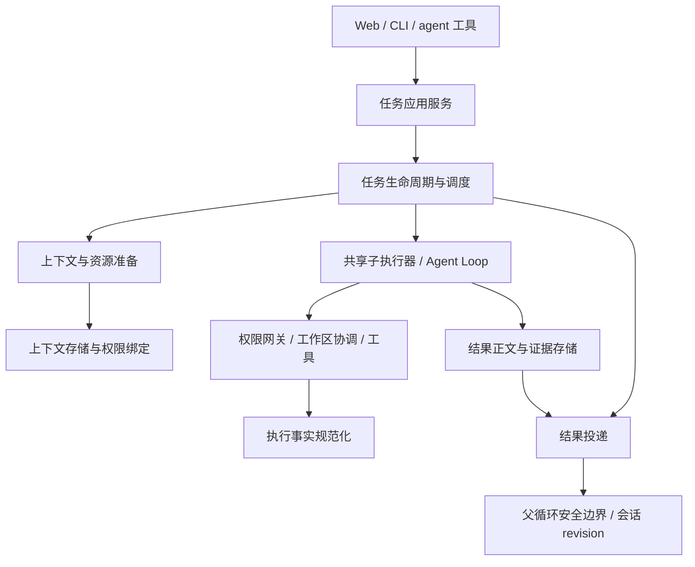

# 子 Agent 架构改善规划

状态：当前已确认A—E范围开发及有限场景验收完成，2026-10-21。已补齐共享token预留/结算、文件产物契约与独立验收、双端与浏览器检查、单Agent收益对照。当前结果、非目标和历史待办解释见[交付状态](delivery-status.md)。Worktree、跨进程隔离/恢复和团队编排仍为后续独立需求。

本文件响应“从整体架构和最佳实践规划改善”的要求。用户随后要求开始实施；已选定的范围合并进现有 spec、plan、task、checklist 的 F19/P19/T19、F23/P20/T20、F27/P21/T21、F31/P22/T22、F35/P23/T23、F40/P24/T24、F44/P25/T25 和 F47/P26/T26，原批准记录保留。最近交付见[当前版本收口验证](../../evals/sub-agents-final-delivery-2026-10-21.md)；路线图其余内容仍是提案，不代表已实现。

## 1. 目标与判断依据

把子 Agent 定义为“由运行时管理、有明确委派契约、独立上下文、受限权限、可取消且可验证的子任务”。模型负责任务推理；运行时负责生命周期、资源和事实；父 Agent 负责整合与最终验收。

依据当前源代码以及[全面评估](../../evals/sub-agents-comprehensive-2026-10-20.md)。上一轮 712 项回归通过、36 个真实样本 31 通过/5 未通过是历史证据，本次规划没有重新运行测试。其中四个失败重复暴露取消事实丢失，一个属于模型召回失败；准备期取消的接口一致性问题由确定性 Runtime/HTTP 复现确认。

现有共享 Agent Loop、子权限网关、上下文引用迁移、结果正文存储、会话 revision 和安全边界投递值得保留。主要改造对象是各模块之间的契约及所有权，而非重新实现模型循环。

比较三个方向：

| 方向 | 收益 | 代价与结论 |
| --- | --- | --- |
| 在现有分支逐个补异常 | 局部改动少 | 接纳、停止、清理仍缺少统一语义；不采用 |
| 保留执行内核，重建任务契约及生命周期所有权 | 能同时处理取消、超时、重复请求和交付一致性 | 需要分阶段迁移调用方；推荐 |
| 重建持久化分布式任务平台 | 可支持进程故障恢复、跨机器调度 | 超出当前本地产品需求；本轮不引入 |

## 2. 目标模块与唯一责任



这些是职责边界，不要求每个框都成为一个类或服务：

| 边界 | 所有权 | 当前代码迁移方向 |
| --- | --- | --- |
| 任务契约与状态转换 | 合法状态、事件、停止归因和不变量；不执行 IO | `core/sub-agents`、`runtime/task-transitions.ts` |
| 任务应用服务 | 输入校验、scope、角色/预算解析；统一双端调用 | 从 `agents/delegation.ts` 收敛入口编排 |
| 生命周期管理器 | ID、去重、接纳、取消、deadline、终态发布 | 重构 `background-task-manager.ts`，禁止外部直接修改状态 |
| 调度 | 并发名额、公平性、排队取消；不构造模型会话 | 可先作为管理器内独立组件；独立 Skill 共用名额 |
| 子执行准备/执行 | 快照、引用、会话、资源释放；返回执行观察 | 复用 `child-execution`，减少委派工具中的资源闭包 |
| 工具结果规范化 | 保留已知执行事实并记录控制层停止原因 | 共用 `tools/registry.ts`，不在 handoff 猜测补字段 |
| 结果投递 | 可重试投递、检查点确认、去重和世代失效 | 复用 `child-result-delivery.ts`，仅通过明确生命周期接口交互 |

## 3. 任务契约

建议定义一个版本化内部任务契约：目标、输入引用、预期产物/验收要求、上下文策略、有效权限、预算、工作区策略和父运行关联。避免把所有内部字段直接暴露为冗长的模型工具参数。

- 模型提供目标、必要上下文和期望输出；运行时解析角色、权限、模型与硬预算，模型不能自授权。
- 保持现有 `agent start/status/wait/cancel/result` 操作，接纳后返回任务 ID 和真实状态。
- defined 默认用于自包含任务；Fork 用于确实需要历史的任务，保留已有类型选择能力，不按提示词关键词偷偷切换类型。
- 接纳时冻结角色版本、任务输入、上下文快照与上限；执行时仍检查动态权限撤销。冻结快照不代表冻结授权。
- 同一 scope、epoch、turn、call 对应同一创建请求；相同 key 不同输入应明确拒绝。去重保留期内返回同一任务，不隐式重新执行。
- 只有用户可见的显式重试才创建新 attempt，并保留来源。对可能已经产生副作用的任务，不自动重新运行。

## 4. 生命周期与停止协议

推荐选择“接纳即建立稳定任务记录”：输入校验通过并预留容量后即接纳；异步准备失败也是该任务的终态。它符合原规格的“创建立即返回 ID”意图，并消除调用者对 prepare 是否已经完成的猜测。

```text
校验/容量失败 → 拒绝（无已接纳任务）
接纳 → preparing → queued → running → terminal
           └────────┴────────┘
                   ↓
                stopping → terminal
```

- 接纳的线性化点是记录与去重索引一起建立。重复调用共享该接纳操作；准备只启动一次，不等 prepare 完成才认可 ID。
- preparing 消耗任务容量，但不占模型执行名额；准备本身使用有界并发，避免大量 Fork 复制拖垮 IO/内存。
- 一个任务级取消控制器覆盖准备、排队、工具执行和资源初始化。绝对 deadline 从接纳起计，包含排队和准备时间。
- 接纳前父请求取消可中止创建；接纳后任务归运行时所有。父轮结束、SSE 断开、wait 超时仅结束等待/转后台。显式取消、清空所属世代、运行时关闭才请求终止任务。
- 同步 Skill 保留随调用者结束的行为；通过执行所有权策略表达，不把后台子任务的规则强加给所有子执行。
- 首个被接受的停止事件确定控制层归因；已提交终态后取消返回原终态，不追溯覆盖成功。执行观察可以显示停止发生前已经完成的操作。
- 生命周期管理器负责终态一次发布、名额一次释放；准备/执行资源通过同一个幂等释放入口管理，部分初始化失败也必须清理。
- 停止请求不等于资源已退出。无法及时退出时保留 stopping 和诊断；接口可返回“已请求停止”，不能报告清理成功。清理失败有独立字段。
- 本地配合取消的操作应有明确超时；若 IO/外部执行器不响应取消，不以 `Promise.race` 的返回伪装进程终止。释放写入独占权前必须确认执行器已停止。
- 已可见 ID 在保留期内保持可查；淘汰遵循明确的已投递/已失效及容量策略，不能在 prepare catch 中直接删除。

上述“一次”保证限定在单运行时、记录保留期内，不承诺跨进程 exactly-once，也不承诺任意命令副作用幂等。

## 5. 结果、证据与投递

结果应明确分离：

1. **控制层结论**：任务状态、停止来源、预算耗尽、清理状态。
2. **执行事实**：实际工具调用、stdout/stderr 或其引用、退出码/信号、截断、已观察副作用、用量与证据关联。
3. **模型产物**：最终文字、制品引用、模型提出的结论。
4. **验收结论**：基于具体检查得出的通过/失败/未验证，不能由模型自称完成直接生成。

共用工具执行协议必须同时处理取消、超时、异常和正常完成：已返回的事实保持原样，未观察字段保持未知。任务因取消结束和某个命令已执行成功可以同时成立。deadline 先到但执行器稍后才返回时，要区分控制请求时间和执行器停止时间，保存迟到观察，禁止触发第二次任务执行或第二次终态投递。

handoff 是执行事实的有界投影；省略必须计数，正文可以分页取回。摘要压缩也应保留停止来源、证据可用性和结果引用；不保证在父提示词里塞入全部命令输出。

投递继续使用 pending → staged → committed，与执行状态正交。只有父检查点成功持久化后才确认 committed；保存失败、父轮中止、重入消费均可按 taskId 去重重试；旧 epoch 的结果不能进入新会话历史。不得宣称已有跨进程恢复能力。

## 6. 上下文、权限与工作区

上下文准备产出显式清单：来源快照、消息范围、字节数、被省略内容、引用迁移映射及版本。Fork 继承的是接纳时可用快照，不能承诺恢复已经丢弃的历史。精确事实任务提供可验证引用及检索能力；不针对评测标记添加提取规则。

有效权限取父授权、角色限制、运行模式和当前动态限制的交集。后台审批不能悬挂等待一个已经离开的父 UI；必须有明确的待授权/拒绝结果及恢复策略。外部 MCP 连接和调用继续分别通过权限门禁，凭据不进入上下文清单。

**共享 Workspace 的命令级写锁只避免同时写，不避免“读旧值后再覆盖”的逻辑冲突。**

推荐本轮采用可落实的工作区模式：

- 独立只读任务可并发；只读能力必须由工具策略落实，任意 shell 不能仅凭角色名被视为只读。
- 共享目录内，可能修改代码的任务采用任务级独占执行；父 Agent 的冲突读写也经相同协调规则，避免读到未完成的中间态。
- 任务等待不得持有它所等待子任务需要的锁；明确锁获取顺序和父级让出所有权的边界，覆盖死锁测试。
- 文件所有权可作为分工提示；在 shell 尚不能可靠限制写入范围时，不把它宣传成安全隔离。
- 独立 Worktree 与合并验收作为后续并行编码阶段：处理脏基线、冲突、清理和制品迁移。它仍不能隔离端口、数据库或外部服务。

这会牺牲共享目录并行编码吞吐，换取可解释一致性；评测必须测量代价，不宣传所有子任务都会加速。

## 7. 预算与可观测性

保留每任务轮数/时长/容量上限，并规划父任务组总预算，避免每次委派都获得一份无限可续的独立额度。并发预算预留后结算真实 usage，缺失 usage 标记未知；token 预估不是厂商硬计费上限。

记录 taskId、parentRunId、callId、epoch、attempt、阶段时间与停止原因。区分准备耗时、排队耗时、模型/工具耗时、清理耗时、投递延迟。活动日志用于诊断，不引入完整事件溯源平台。

## 8. 迁移路线与阶段验收

| 阶段 | 交付 | 验收关口 |
| --- | --- | --- |
| A：统一领域语义 | 整合规格；任务契约、接纳线性化点、信号所有权、状态转换表 | 明确每个事件的允许状态、拒绝行为、资源所有者；将现有失败最小复现纳入仓库 |
| B：生命周期内核 | preparing、一次接纳、统一取消、资源释放、调度与稳定 ID；同步 Skill 兼容 | 准备各 await 点取消/超时/关闭；同 key 并发成功/失败；HTTP 可见任务终态一致；无重复执行/清理 |
| C：执行与结果协议 | 共用事实规范化；终态、正文、摘要及投递确认一致 | 父/子命令输出保留；完成/取消相邻竞态；迟到返回；检查点失败后重试；旧 epoch 隔离 |
| D：协作边界 | 上下文清单、输入输出契约、共享目录独占策略、预算归属 | 快照不可变、引用拒绝越界、权限撤销、父子写冲突/死锁、Skill 与任务公平性 |
| E：双端验收与收口 | UI/CLI 显示真实准备/停止状态；统一评测和文档 | 完整回归、lint/typecheck/build；真实浏览器与 tmux；隔离真实模型对照与失败分布 |

每阶段替换一项所有权或契约，兼容适配器只放在边界；迁移结束删除旧路径。避免旧 manager 和新 manager 同时持有任务。不得双跑有副作用任务来做“影子比较”；可重放合成事件和只读结果进行比较。

## 9. 测试与成功标准

- 确定性测试：状态转换表、受控异步屏障、伪时钟、随机固定种子事件序列；断言并发上限、终态不回退、资源只释放一次、停止后不再启动。
- 集成故障注入：历史复制、MCP 初始化、命令执行、结果存储、检查点保存的失败与取消；逐层验证实际暴露的 HTTP/CLI 行为。
- 工作区验收：真实文件与进程观察，不只检查最终回答；取消后已知进程退出，无计划迟到写入，必要时观察子进程树。
- 真实模型评测：先固定模型、配置、隔离数据、场景和成功判据；比较单 Agent 与委派，以及 defined 与 Fork；保留首次失败、重试和全部成本，不能用最终重试替换失败。
- 工程不变量要求全部通过。语义任务报告重复样本的完整分布、任务成功率、证据正确率、耗时和 token；不从少量样本承诺通用成功率，也不把“用了子 Agent”当成收益。
- 新增任务编排层前先证明现有委派比单 Agent 在至少一类实际任务中改善质量、隔离性或延迟，且成本可接受。

## 10. 参考与适用边界

- [Building effective agents](https://www.anthropic.com/engineering/building-effective-agents)：采用简单可组合模式，围绕工具反馈与可测结果增加复杂度。本方案只借鉴架构原则，不引入文中 SDK。
- [How we built our multi-agent research system](https://www.anthropic.com/engineering/multi-agent-research-system)：明确分工、上下文与输出要求，并以任务结果评测。研究检索场景的收益不能直接外推到共享代码目录的并发编辑。

生命周期线性化、任务级独占、清理与投递协议是结合 OrbitCode 当前实现提出的设计决策，不是上述文章保证有效的现成实现。后续以阶段测试和实际成本决定是否继续扩大并行能力。
