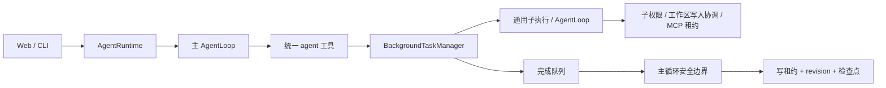

# 子 Agent 委派与后台任务 Plan

状态：已批准

2026-10-20至2026-10-21追加实施决策：任务接纳、准备及投递语义以本文件末尾 F19/P19/T19、F23/P20/T20、F27/P21/T21、F31/P22/T22、F35/P23/T23、F40/P24/T24、F44/P25/T25 及 F47/P26/T26 对应章节为准；其余既有约束继续适用。
依据：已批准的 `spec.md`；用户于 2026-10-19 授权开始开发。
当前决策：2026-10-20用户授权撤下report_completion；以文末T15/P15及对应决策为准，早期报告方案仅保留历史记录。

## P1：架构与现状

主链路保持 `Web/CLI → AgentRuntime → createAgentSession → AgentLoop → 工具策略/Provider`。新增运行时持有的任务管理器及通用子执行层；核心只依赖注入的任务接口，不导入运行时实现或 UI。

已核对的基线：

- `skills/isolated-runner.ts` 已负责临时存储、历史迁移、子轮次和结果汇总，但组合了父取消信号，并在返回前清理所有资源。
- `skills/session-factory.ts` 已创建独立上下文、进程控制、完成追踪和用量；审批仍使用父轮次网关。
- `skills/history.ts` 按完整消息组校验、迁移卸载引用，并限制 1 MiB；运行时传入的是轮次开始的 `locked.context.messages`。
- `AgentLoop` 在整批工具执行完成后才追加工具交换，因此委派工具执行期间可读取不含当前工具组的完整上下文；不能使用只包含普通对话的 `getHistory()` 作为 Fork 来源。
- `AgentRuntime.prepare` 的清理会释放 MCP 租约和权限轮次；`close()` 目前关闭记忆服务和 MCP。后台任务必须有自己的租约和权限所有权。
- `ConversationOperationGuard` 和会话仓库已有写租约、revision、pending-save；继续使用这些机制。
- Provider 已输出 `PromptCacheUsage` 判别联合，运行时 `ModelUsageTracker` 尚未保留缓存统计；扩展既有解析结果，不建立第二套缓存协议。



## P2：领域契约与统一工具

在 `src/core/sub-agents/types.ts` 定义判别联合和只读契约。以下是关键签名，引用的现有类型沿用其原定义；具体错误字段在实现时按现有工具错误模型展开。

```ts
type AgentStart =
  | { readonly kind: "defined"; readonly role: string;
      readonly prompt: string; readonly background: boolean }
  | { readonly kind: "fork"; readonly role?: string;
      readonly prompt: string; readonly background: true };

type AgentToolRequest =
  | { readonly operation: "start"; readonly task: AgentStart }
  | { readonly operation: "status"; readonly taskId?: string }
  | { readonly operation: "wait"; readonly taskId: string; readonly timeoutMs?: number }
  | { readonly operation: "cancel"; readonly taskId: string };

type TaskState =
  | { readonly status: "queued" }
  | { readonly status: "running"; readonly startedAt: number }
  | { readonly status: "stopping"; readonly reason: "cancelled" | "max-runtime" | "runtime-closed" }
  | { readonly status: "terminal"; readonly result: ChildExecutionResult };

type TaskDelivery =
  | { readonly status: "pending" }
  | { readonly status: "staged"; readonly turnId: string }
  | { readonly status: "committed"; readonly revision: number }
  | { readonly status: "invalidated" };

type ChildExecutionResult = {
  readonly taskId: string;
  readonly stopReason: AgentStopReason;
  readonly terminationSource?: "user" | "runtime-close" | "parent-cleared";
  readonly finalReply?: string;
  readonly failures: readonly ChildToolFailure[];
  readonly sideEffect: SideEffectState;
  readonly verification: CompletionAssessment;
  readonly usage: ModelUsageSummary;
  readonly cleanup: "complete" | "failed";
  readonly truncated: boolean;
  readonly evidenceRunId: string;
};

interface TaskControl {
  start(request: AgentStart, origin: DelegationOrigin): Promise<TaskView>;
  status(scope: TaskScope, taskId?: string): readonly TaskView[];
  wait(scope: TaskScope, taskId: string, options: WaitOptions): Promise<WaitOutcome>;
  detach(scope: TaskScope, taskId: string): void;
  cancel(scope: TaskScope, taskId: string): Promise<TaskView>;
}
```

`TaskScope` 包含运行时实例 ID、会话 ID、lifecycleEpoch；来源、父轮次、调用 ID、Workspace、权限上限和上下文快照只能由运行时注入，不能由模型伪造。`WaitOutcome` 区分已结束、超时、手动结束等待和等待方取消；这些结果都不表示子任务取消。`ChildToolFailure` 保留工具名、错误种类和命令退出/超时事实，任意错误文本先脱敏和截断。

模型只看到一个 `agent` 工具，`operation` 为 start/status/wait/cancel。角色目录名称和简介进入可选提示背景，完整角色在创建时加载。定义式默认 `background=false`，返回 ID 后提示主 Agent 调用 wait；Fork 显式 `background=false` 拒绝。status 省略 ID 时仅列当前会话任务，全部操作均验证归属。工具以调度屏障处理，但不获取工作区写入锁；wait 使用父轮次预算而非普通文件工具 10 秒预算，并取用户等待时限、父剩余时限的最小值。

创建的幂等键为运行时实例、父会话世代、父轮次及工具调用 ID。同一调用重复执行只返回原任务，不重做工具。创建接纳前校验、预留容量并固定逻辑快照；引用复制在已接纳任务的 preparing 阶段完成。父调用信号只约束接纳前，准备与执行均由任务信号控制。

## P3：角色定义和配置

新增项目 `.orbitcode/agents/*.md`、用户配置根 `agents/*.md` 和仓库内置 `agents/*.md` 三层目录，只扫描直属 Markdown 文件。项目 > 用户 > 内置；同层重名报错，坏的高优先级定义阻断回退。入口真实路径必须在对应可信定义根下，符号链接不得逃逸，正文不作为代码执行。

```yaml
---
name: explorer
description: 只读探索代码与相关上下文
allowed-tools: [read_file, find_files, search_code, read_context, read_memory, load_skill, read_skill_resource, report_completion]
disallowed-tools: [agent, write_file, write_files, edit_file, run_command, start_process]
model: inherit
max-iterations: 16
permission-mode: default
---
```

字段全部必填，白黑名单使用精确工具名，空白名单表示无可用工具，黑名单优先；未知键、重名键、YAML 别名/锚点/自定义标签拒绝。MCP 名称可以声明但不因此连接；创建时未发现所需身份报错。名称、简介、定义大小沿用 Skill 的限制：名称 64 字符、简介 200 字符、入口 64 KiB、frontmatter 8 KiB、任务输入 16 KiB；目录最多 128 个有效候选、提示摘要最多 16 KiB，超限提供明确诊断，不发送误导性残缺目录。

内置 `general`、`explorer`、`reviewer`。general 使用现有本地工具中除 agent 以外的集合，独立 Skill 仍由硬约束禁止；explorer/reviewer 只允许上例只读及完成报告工具。自定义角色可精确声明 MCP 工具。Fork 不选角色时模型继承，工具以父工具上限过滤，附加“完成指定子任务、不得委派、结构化报告事实”的子执行指令；选角色则继承父背景后叠加该角色。

角色指令放入独立持续提示槽，压缩只作用于对话，不压缩掉角色槽。Fork 复制父已激活 Skill 快照与对应只读定义数据，重新建立资源跟踪，子侧停用不能去掉父有效工具上限；定义式不复制父激活指令，但始终继承父限制。

共享托管设置增加 `subAgents`，旧配置缺失时使用 Spec 默认值。通过现有设置页运行参数区编辑；Web 和 CLI 均由 `runtime/config.ts` 解析。有限上限为：每轮创建 1—32、任务记录 1—256、子并发 1—8、子迭代 1—32、子时限 1—1440 分钟、单次等待 1—300 秒，并校验并发不大于记录容量。父设置为 unlimited 时仍受子有限上限；有效迭代与时限取角色、子设置、父配置的最小有限值。已经启动任务不因配置增大而延长。

## P4：通用子执行与 Fork

新增 `src/runtime/child-execution/`，负责历史迁移、独立会话、事件汇总和资源作用域。现有 Skill runner 改为薄适配器，保持原有输入、结果格式和父预算；Agent 适配器由任务管理器驱动。共用 `AgentLoop`、`createAgentSession`、`runAgentTurn`，不复制算法。

Fork 在工具批开始执行前，获取当前 `ContextManager` 已提交完整组的深拷贝；这个时点包含本轮用户输入和此前完整批次，不含当前未完成批次。所有本批 Fork 采用相同历史边界。若历史本身已有不完整组则拒绝，不从损坏历史猜测恢复。

通用历史迁移保留现有 1 MiB 总容量约束、消息配对校验和结构化卸载引用拷贝。使用唯一子会话 ID 写入专属 `LocalContextStore`；纯文本旧引用替换为不可用说明，不重新解释成可读引用。复制/展开失败释放已取得资源并发布准备失败终态，记录仍占容量直到按投递/失效策略退休。任务接纳后迁移；父 clear/delete 按世代失效协议先停止准备，不能绕过任务所有权直接删除仍在迁移的父存储。

定义式初始消息为空，子输入为任务 prompt；Fork 初始消息为快照，再追加任务 prompt。克隆项目规则、提示环境、父 Skill 快照等不可变背景；所有 `ContextManager`、`CompletionTracker`、SkillSession、资源读追踪、进程控制器、权限 broker、用量 tracker 和取消控制新建。

提示构造保持固定系统段和历史顺序；子约束/角色增量追加至专用槽，工具 schema 必须先过滤。迁移导致引用和摘要变化、角色切换模型、不同工具集合时可能损失缓存，不保留越权工具以换取缓存。缓存字段沿用 Provider 现有 `PromptCacheUsage`，不新增厂商缓存请求参数。

## P5：权限与递归边界

新增 `ChildToolPolicy`，位于模式限制与角色/Skill 可用性组合的外层：父工具快照 ∩ 角色白名单 ∩ 当前共享 Skill 限制 ∩ 模式允许，扣除角色黑名单和 agent。该外层同时校验 definitions/classify/prepare/executePrepared；不能让 `load_skill` 的已有豁免跳过它。子加载器解析到 isolated 时在启动之前拒绝。

权限模式不按字符串简单排序。每次操作对父创建时的规则/模式快照、父当前有效撤销/限制、角色模式分别求值，按 deny > ask > allow 合并；后台再把 ask 转为结构化 permission-denied。父会话原本的临时单次批准不作为可继承权力。每个子独立 broker，仅支持子任务内 once 授权，不持久写入父 session 或权限文件。

权限追踪由任务作用域持有，不复用父 `turn.broker`。父轮次结束不是撤销整个权限上限；收紧通知通过运行时级权限版本和只读规则源到达子任务。父授权会话失效且无法重新验证时 fail closed，不能回退为 permissive。模式变化、清空和权限变更发布到任务管理器，但不共享可变会话实例。

仅定义式前台任务且有活跃交互宿主时可展示子审批。创建至首次 wait 的间隙允许挂起子独立审批，由宿主按任务 ID 展示；前台等待计时从接纳时开始，若主 Agent 未调用 wait，到默认等待期限自动转后台。显式后台、非交互 CLI 及 Fork 从开始就不等待审批。进入后台是单向状态，后续 wait 只观察，不重新开放审批。转后台取消未决请求、提高审批世代，迟到批准拒绝；已开始工具不因单纯 detach 自动取消。

## P6：任务状态、预算和资源所有权

`BackgroundTaskManager` 由 `AgentRuntime` 构造并持有。执行状态与前台/后台状态、投递状态正交；排队、运行、停止中最终进入 terminal。执行结束先收集结果、回收资源，再发布单一终态；清理失败附加事实，不覆盖原 stopReason，也不抹去副作用。

创建时确定绝对 `deadlineAt`；排队、审批、MCP 初始化、锁等待和子执行均用同一截止时间。启动 `runAgentTurn` 时传入剩余时长，转后台不能新建计时器延长期限。任务自身取消信号由任务控制器、总截止和运行时关闭组合，不包含父 HTTP/轮次信号。父信号只控制接纳前校验和前台 wait，已接纳的准备由任务信号控制。

通用子执行使用统一并发许可池，独立 Skill 占一个子执行槽并沿用父剩余时限；因为子级禁止独立 Skill 和委派，不存在子持槽等待孙任务的死锁。父等待不占子许可。创建失败释放预留；排队取消、排队到期均不启动模型。

任务独立申请 MCP 租约，即使复用底层已连接 client 也增加自己的引用；执行调用包装器绑定子网关和子信号，不能复用捕获父 broker 的工具实例。新连接与调用仍分别授权。父租约释放不影响子租约；子终止释放自身租约，运行时 close 先取消/等待全部任务和受管进程，再关闭 MCP 管理器与记忆服务。

等待超时或断连只调用 detach；显式取消幂等地触发任务控制器。关闭时停止接纳，取消所有排队和运行任务，停止受管进程，等待清理；清理错误保留可诊断状态，不宣称所有资源已释放。父 clear/delete 先取得原会话操作资格和写租约，在同一操作边界内失效该世代、取消任务并保存清空或删除结果；与正在运行父轮次冲突则遵守原 busy/cancel 语义，不能在请求尚未取得资格时提前取消子任务。失效后若落盘失败，保留错误与失效事实，不恢复已取消任务或重放其结果。

终态记录保留到已投递且超过 30 分钟，或容量压力下按最早已投递记录清理；未投递/staged 记录禁止驱逐。清理后查询返回已不可用，不自动恢复。执行上下文目录在终止时删除；摘要与证据 run ID 保留，日志沿用现有本地运行记录保留策略。

## P7：结果队列、边界与持久化

任务完成事件只由管理器入队。`AgentLoop` 注入两个核心契约：读取委派快照、在安全边界领取结果；实现由运行时提供。消费点为本轮用户输入进入上下文后、请求模型前，以及完整工具交换追加后、下一个请求前。流式响应途中不消费；最终回复已决定结束时不为新结果再开一轮，结果留待下次。

队列以 runtimeId/taskId 标识一个结果，按完成入队顺序交付；批次有界。写入专用 `child-result` 上下文消息，渲染为明确的低信任外部执行事实，不能升级为 system 指令或伪造 tool result。扩展消息分组、token 估计、压缩和模型渲染对新消息的处理；压缩可以压缩正文，不能据此清除投递回执。

领取使用 claim/stage/commit：

1. 父持有本轮会话租约，按会话 ID/世代领取 pending 项，标记 staged(turnId)。
2. 向本轮上下文追加一次结果，并向待保存检查点加入 `childResultReceipts`，包含 runtimeId、taskId 和结果事件标识；该字段是可选的，旧检查点默认空。
3. 原 persistTurn 同一 revision 保存上下文、展示摘要及回执，成功后 ack 管理器。保存失败保留原 pending-save 及 staged 项，禁止下一轮绕过未保存状态。
4. `/retry-save` 只保存该快照，成功后核对回执再 ack，不重跑模型或工具。若已经保存但 ack 失败，下次加载发现回执后只补 ack。
5. 接纳本轮前未进入快照的排队结果保持 pending；会话清空更换世代并清空旧回执/队列。旧运行时的回执不代表可恢复任务。

活跃回执只需覆盖管理器尚保留的记录；清理记录后其幂等登记也不能重新变成可执行调用。父轮次唯一 ID 的历史创建键只接受当前执行轮次，旧轮次重放拒绝。新检查点可移除已失效运行时回执及已被管理器退休的回执，历史展示仍保留任务身份，防止回执无界增长。

status/wait 可以读取结果，但不改变队列投递状态。wait 的工具结果只返回状态和简短停止摘要，完整结构化结果统一由队列消息送达；避免一份结果同时作为工具正文和队列正文重复进入上下文。Web 通知是界面刷新信号，不写父历史、不触发模型。

## P8：工作区写入协调

新增 `WorkspaceExecutionCoordinator`，按工作区 canonical root 提供 FIFO、可取消的写入许可。共享同一运行时的父、子和独立 Skill 在 `ToolScheduler` 获得实际执行许可；模式/参数/授权检查在锁前完成，拿锁后再次验证权限与路径，再执行。锁等待计入工具及任务截止时间。

文件写、命令、外部 MCP 默认需写入许可；本地只读工具并发。`agent` 的控制/等待和 `load_skill` 的编排本身不持工作区锁，内部真正的写工具分别取锁；否则父等待子会死锁。未知外部工具不依赖模型自报 read-only 放宽锁。

`start_process` 的潜在写入许可移交给进程控制器并一直持有至退出/停止。`process_status` 与 `stop_process` 不再次排队申请同一写锁，允许释放进程；新写入因长进程而等待到期时报告 conflict/timeout，不能提前释放保护。运行时关闭逐一终止进程后释放；不能终止时报告清理失败。该保守策略可能降低开发服务器与其他写任务的并发能力，作为本阶段明确代价。

同运行时以不同 ID 指向同一真实路径时仍共用锁。不同进程、重叠但不相同的工作区根及外部程序不在本轮锁保证内，界面不得宣称文件隔离；原读后校验和副作用验证继续生效。

## P9：双端接口与用量

`AgentRuntime` 暴露角色列表、任务列表/详情、wait/detach/cancel，工具和入口都调用它。Web 新增会话下 agents 和 tasks 路由、任务详情及 wait/detach/cancel 子路由；沿用本地请求校验和权限会话绑定，客户端不能指定 Workspace 路径、权限上限、模型凭据或任意父会话作用域。列表查询使用有界轮询，无需新 WebSocket。wait 有截止并支持请求取消，断连触发 detach；无生成流时任务管理也可访问。

Web 任务面板显示角色、类型、状态、预算、最终结果、验证边界、审批归属和投递状态，提供等待、转后台、取消按钮；角色查看与任务管理不要求主 Agent 再调用模型。CLI 增加 `/agents`、`/tasks`、`/task show <id>`、`/task wait <id>`、`/task background <id>`、`/task cancel <id>`。等待时保持控制输入通道可用，Ctrl+C 结束等待；取消必须显式命令。非交互 run-once 在最终输出前关闭运行时，把尚未完成任务的取消事实加入输出，不把这批结果强行投递为新的父模型轮次。

扩展 `ModelUsageTracker` 各用途桶的可选缓存观测计数，分别累计 tokens/status/unavailable 请求，缓存 token 缺失不补零。父 `scope:self` 保持原义；新增任务级 usage 与聚合视图，按任务 ID 去重，模型执行、摘要用途分别统计。父轮次日志不在结束后被后台修改；最终子用量进入子日志/任务记录，运行时视图按查询时点汇总。JSON 校验接受旧记录缺少新字段，非法新统计拒绝。

## P10：文件组织与需求映射

新建文件按职责列出，测试文件与各实现同目录；下表中的目录只创建实际使用文件，不生成空骨架。

| 文件/边界 | 职责 | 需求 |
| --- | --- | --- |
| `src/core/sub-agents/types.ts` | 领域请求、状态、结果及注入接口 | F1、F7、F10、F15 |
| `src/runtime/agents/{definition,catalog}.ts`；`agents/{general,explorer,reviewer}.md` | 三层角色定义、诊断、快照 | F2、F3 |
| `src/runtime/child-execution/{history,session-factory,runner,result}.ts` | 通用历史、独立会话、资源、结果 | F3、F4、F5、F7、F15 |
| `src/runtime/skills/{history,session-factory,isolated-runner,execution-summary}.ts` | 兼容旧 Skill 的薄适配 | F7、F9 |
| `src/runtime/{background-task-manager,child-permissions,workspace-execution-coordinator,child-result-delivery,sub-agent-usage}.ts` | 生命周期、权限、写入协调、投递 | F8、F10—F14、F17、F18 |
| `src/tools/{agent,child-tool-policy}.ts`；既有 registry/types/skill-policy/managed-process | 统一工具、递归拦截、许可传递 | F1、F8、F9、F11、F18 |
| `src/core/agent-loop.ts`、`tool-scheduler.ts`、`context/`、`system-prompt/` | 快照边界、消费边界、消息渲染及角色槽 | F4、F6、F13 |
| `src/runtime/agent-runtime.ts`、`agent-session-factory.ts`、`run-agent-turn.ts`、`mcp-connections.ts`、`mcp-initialization.ts` | 生命周期接线、独立 MCP 租约和清理 | F7、F10、F12 |
| `src/core/conversations/{types,validation}.ts`；`src/lib/local-conversation-store.ts`；`src/runtime/conversation-{runtime-manager,service,cleanup}.ts` | 回执、保存重试、世代失效 | F12、F14 |
| `src/runtime/{settings-types,settings-service,config}.ts`；`src/lib/local-settings-store.ts`；`src/components/settings/runtime-settings.tsx` | 有界配置和旧配置兼容 | F17 |
| `src/models/usage-tracker.ts`；`src/runtime/agent-run-tracker.ts`、`types.ts` | 缓存观测、父子统计与事件 | F6、F19 |
| `src/web/agent-task-http.ts`；会话 agents/tasks 路由 | Web 控制与作用域验证 | F16 |
| `src/components/agent-task-panel.tsx`、`use-chat-workspace.ts`、`chat-workspace.tsx`、`permission-request-card.tsx` | 任务、角色和子审批展示 | F8、F16 |
| `src/cli/{agent-commands,commands,session-controller,terminal-chat,run-once}.ts` | CLI 管理、等待交互和关闭报告 | F12、F16 |
| `tests/helpers/sub-agent-fixture.ts`、`tests/sub-agents*.test.ts`、`scripts/run-sub-agent-fixture.ts` | 确定性双端与手动验收替身 | 全部 AC |
| `README.md`、`docs/evals/sub-agents.md` | 使用和证据边界 | F15—F19 |

## P11：错误与安全约束

参数/角色错误、无权任务 ID、容量上限在接纳前返回结构化错误；快照无法迁移以及其他已接纳任务的初始化失败进入 agent-error 终态。可恢复工具失败仍交给子循环；最大轮次、运行时限、致命 Provider 错误由原循环停止规则处理。取消使用 cancelled 并附 terminationSource；清理失败作为附加字段，不把已应用副作用变成 none。

背景状态是独立于前台审批的约束，cannot-prompt 返回 permission-denied 并标明后台/非交互原因。所有工具 schema 与执行均受白黑名单；模型选择、角色、任务 ID 不构成授权。日志只记录脱敏标签、摘要和现有运行证据，不写 API Key、完整环境或 MCP 秘密。

## P12：依赖、取舍与验证

不新增运行时依赖。使用已有 `yaml`、Node 标准库、现有 AbortController、MCP 管理器及测试运行器；不使用任何被禁止的 Agent SDK。配置解析与上下文消息是现有接口扩展，不引入跨进程任务数据库。

| 决策 | 选择及理由 | 未采用方案 |
| --- | --- | --- |
| 子执行复用 | 提取共享基础设施，Skill 保留适配语义 | 复制 Skill runner 后独立演进容易漂移 |
| 创建/等待 | 先 ID 后 wait，转后台不改变执行身份 | 长调用中隐式重建子任务会重复副作用 |
| 写入协调 | 工作区保守串行，能覆盖未知命令/MCP | 细粒度路径锁需要可靠声明全部副作用，当前没有 |
| 结果持久化 | 原租约下提交回执与上下文 | 回调直接保存会与主轮次竞争 |
| Fork 缓存 | 尽量保持前缀，安全过滤优先 | 保留越权工具或父引用不可接受 |
| 后台恢复 | 只在当前运行时持有 | 跨进程恢复扩大本轮范围 |

验证依次覆盖领域解析、权限交集、并发/取消竞态、历史迁移、队列提交故障注入、MCP 租约、双端端到端及旧 Skill 回归。模拟时钟与本地 Provider/MCP 替身提供可重复序列；缓存使用已知 usage 样本，不要求真实命中。实现完成后全量测试，再依次 lint/typecheck/build，随后真实浏览器和 tmux 检查。具体命令、证据和未通过状态见 `task.md` 与 `checklist.md`。


实施机械拆分：委派装配位于 `src/runtime/agents/delegation.ts`，统计位于 `sub-agent-usage.ts`；MCP 租约和保存重试分别增加独立 e2e 测试，职责与上述设计保持一致。最终实际证据见 `checklist.md` 和 `docs/evals/sub-agents.md`。

## P13：真实模型问题的既有能力修正（2026-10-20）

用户授权改进后，提取 `agents/child-instructions.ts` 装配持续子指令；`runChildExecution` 仅在最后追加的子任务消息标记当前执行目标，完整父历史及配对保持原样，稳定请求前缀不插入任务动态值。

`context/context-read-payload.ts` 在轻量压缩中识别实际 read_context 调用配对的成功结果，按单结果预算及批次均分预算裁剪可见正文，按 Unicode 字符更新原引用的 nextOffset/hasMore；不生成二次卸载引用，不豁免预算。元数据与最小正文也无法容纳时结构化容量停止。普通工具结果沿用原卸载。

`ChildHandoff` 复用命令摘要，保留 callId、退出码、失败/成功总量和最近16条结果；文件工具已确认写入最多8个路径，每路径1024字节，部分批量写入也保留，省略可见。摘要不复制命令正文和stdout/stderr；命令等其他副作用不能由此列举。主投递截断路径继续保留关键交接计数及证据ID，沿用租约和回执。

真实复测脚本入库、原证据仍忽略；固定原任务/预算，所有失败保留。请求前后记录普通文件SHA-256，供复核临时修改和恢复；该评测扫描不是原子文件快照或产品隔离能力。

## P14：完成报告纠错与父汇总事实（2026-10-20）

CompletionTracker新增只读reportCorrection视图：最多16条成功只读/命令证据候选、写入后标记与省略数，不复制参数/输出；候选不代表语义匹配或需求覆盖。report_completion接受器拒绝时在output.reportCorrection返回候选与纠错指引，原error.issues和全部验收规则保持。Schema字段说明区分最终检查与历史过程；AgentLoop仍只允许首次提交及一次纠正。

ChildHandoff从实际report_completion工具结果记录attempts/accepted/rejected/lastAttempt，旧结果可缺字段。投递截断保留调用事实；最终verification仍是单独事实，不能由accepted次数推导。主系统指令区分累计历史、最终报告调用状态和当前验收状态，不把子证据当成本轮父证据。

复用真实模型Fixture，增加五种报告状态及父JSON汇总的逐字段断言，并接入可维护Web HTTP/SSE评测适配器；负向场景预期被拒绝或失效不算产品失败。原始代码修复任务另做独立制品验收和报告完整性复核，保留全部结果。

## P15：按用户授权撤下report_completion（当前方案）

本节取代P14及此前模型自报相关执行要求；用户本轮已授权在确认影响后移除，证据满足条件。删除工具实现/Schema、默认注册、工具名枚举、AgentLoop报告纠错计数及finalOnly强制收尾路径；不保留隐藏开关或以更名工具替代。

CompletionTracker只被动分配运行内证据ID、保持已有纯外部调用observed语义及严格历史Assessment读取；删除accept/reportCorrection/markReportFailure等主动判定代码。新本地操作仍unverified，不将命令成功或最终文本认证为任务验收；已有会话中verified/partial/blocked保持历史原值。模型无需额外报告，可继续使用本轮真实工具完成任务。

ChildHandoff继续收集命令原始退出码与文件工具确认写入，不再生成报告调用计数；可选旧字段仅保留历史读取/投递兼容。角色和Skill元数据对已撤下名称接受后显式过滤，空白名单保持为空，未知名称/重复项仍拒绝。历史完整工具交换保持配对。内置角色/Skill和提示去除自报要求，验收依据实际工具证据和独立检查。

旧工具专属测试和评测入口归档至忽略的本次证据目录，改以工具缺席、正常循环不被报告阻断、普通失败恢复、旧配置/历史兼容、实际修复和独立制品验收测试覆盖。已有安全限制测试不放宽。

## P16：源码探索故障修复

search_code明确path仅目录、file_pattern相对Workspace根；permissionTargetFailure将not-directory/not-file返回invalid-arguments并给出纠正方式，保持真实越界/无效路径拒绝和not-found区分。固定targetFailureReason枚举进入日志和子失败，增加callId/iteration关联，不复制异常正文、用户参数或查询词。

ChildHandoff从成功read_file/search_code结果保留最多16个已读文件及16个命中位置，每路径512字节，只含path/line/callId，不携带源码。它们是工具观察事实，不代表读完卸载正文或理解正确；省略数和截断可见。超长投递压缩为各4条并保留省略数，沿用原会话租约与去重回执。

子执行接近硬轮数上限时，仅在最后3次请求末尾附加运行时预算提示；suffixMessages纳入上下文估算、压缩后的估算及usage校准，不入持久历史。保持既有系统指令与继承历史前缀，工具仍可用，最后一轮工具仍按原上限取消，不额外请求或延长时限。主级指令明确不以独立核实为由违反用户禁止代做的约束；模型遵守质量以实测分布说明。

新增源码隔离副本真实评测入口；src/、tests/和scripts/仍检查，tsconfig与ESLint排除已忽略tmp/评测副本。Web评测器可选生产服务模式，避免占用现有开发服务锁，不停止用户服务。


## P17：整体架构改进实施边界

用户明确要求实施上一轮评估方案。新增 task-transitions 统一终态归因，manager 发布单调完成序号，delivery 分层序列化并保留省略计数。独立 ChildResultStore 位于父会话目录，保存正文、工具事实与哈希；不持久恢复执行任务。现有清空/删除与30天会话清理天然覆盖数据目录，额外读取TTL及写入清扫管理过期正文。配额写入在同一进程按父目录串行，不宣称跨进程事务或全局硬配额。

agent 新增 result 分页；Runtime、Web操作路由、任务面板、CLI /task result 和运行导出共用同一存储。result仅返回低信任模型正文；运行事实另在自动交接及 childToolFacts 中保留。正文保存失败明确降级，不改变已发生工具副作用或伪造保存成功。

ParentExecutionPolicy 在主会话 Skill/模式策略外层执行 definitions/classify/prepare/executePrepared 限制；RunTurnInput、Web协议、CLI交互与单次运行接入结构化契约，保存到 lastTurn。此契约约束父模型工具调用，不改变必要的运行时配置/初始化及后台记忆生命周期。

ChildHandoff 为实际读取记录内容哈希；同一事实投影在子预算末尾进入可计量suffix。正文分页与 read_context 共用预算裁剪及游标，不要求 delegate-only 额外开放 read_context，也不将 agent 的状态/控制结果一律豁免压缩。

保持旧会话、旧结果和省略新字段的调用兼容；既有 MCP、Skill、权限与重试保存回归继续执行。单一路由分发所有已校验任务操作，避免工具、HTTP处理器、页面与路由之间漂移。

## P18：检索与委派契约可靠性

引用访问在共用工具入口区分分页读取和完整字面量搜索，两种本地存储共用自身既有安全加载路径，搜索算法共享；低预算只省略摘录，不改变覆盖事实。ChildHandoff 保留有界搜索元数据。ParentExecutionContract 增加可选 delegationKind，Web/CLI/运行时/持久化共同采用；模型 Schema 与运行时入口一致拒绝不匹配类型。Fork 历史迁移只对实际复制对象建立子执行内引用映射，防止子 prompt 携带旧引用失效，同时拒绝其他父对象。固定真实模型回归与独立原文/工具事实验收保留全部失败，不以最终回复替代验收。详见 [交付证据](../../evals/sub-agents-reliability-2026-10-20.md)。

## P19：任务生命周期内核收敛

依据用户“开始进行改善”的实施授权，按 [架构路线](architecture-roadmap.md) 分阶段替换契约。

`TaskState` 增加 preparing。BackgroundTaskManager 的同步记录/去重登记为接纳点，异步准备不再决定 ID 是否存在。准备和执行使用任务控制器；准备不占执行槽位但受独立并发计数限制。任务终结 Promise 在清理前建立，使取消、关闭、超时共享一次清理、一次终态和一次名额释放。准备失败对外返回 agent-error 终态；资源清理结果通过 TaskPreparationError 传递。

委派边界在接纳前固定历史与 Skill 快照；权限仍动态检查。清理先关闭子会话，再释放权限/租约，最后删除目录，清理 Promise 可重入。终态释放执行/准备闭包，避免保留父上下文。去重墓碑保留最多1024个轮次，活跃轮次不被淘汰；此为进程内有界防重放窗口。

ToolRegistry 以首个停止原因规范化已返回结果，保留 output/meta/sideEffect。deadline 在执行器未返回时仍产生保守未知结果；本次没有实现任意工具迟到结果的追加持久化，不宣称 timeout race 返回等价于进程已停止。

投递的 staged 是未持久确认状态，可以被下一轮重新领取；committed/invalidated 不再领取。缩略结果保留 terminationSource；迟到 commit 不覆盖 invalidated。继续复用原有会话 revision/回执与子执行内核，无新增依赖。

## P20：共享工作区任务级协调

WorkspaceExecutionCoordinator 从写互斥升级为公平读写队列；runTask 持有完整子执行的许可。通过 Node 标准库 AsyncLocalStorage 在任务异步链中传递私有所有权，工具与 MCP 初始化重入复用许可；结束后标记失效，迟到回调不能获取无主许可或跨根升级。

childWorkspaceAccess 复用实际 ToolDescriptor.mutability，按父级可用工具与角色限制的交集计算，未知元数据保守独占。TaskView 和 agent start/status 增加可选 workspaceAccess，旧任务省略字段仍兼容。

父文件工具在调度器 acquireRead/acquire；agent、load_skill、process_status、stop_process 不在调度器持锁等待。父 load_skill 在定义读取期间单独持有读许可，调用独立循环前释放；独立 Skill 整体 runTask，与后台子任务共用现有执行名额和目录所有权。

独占许可在子会话、权限、MCP 租约和上下文清理之后释放；清理失败保持任务结果并使该工作区在当前协调器中进入拒绝新许可状态。WorkspaceAccessError 为核心调度器提供结构化 conflict/permission-denied，避免模型只得到含糊的执行失败。控制操作始终可用。无需新增依赖，未使用任务框架。

写能力任务会牺牲共享目录中的并行吞吐；无角色 Fork 通常继承命令能力，因此按独占处理。长时间持有写许可的受管进程同样会阻塞文件访问，仍可通过进程状态/停止操作控制。此次没有实现父推理级事务、跨进程锁或 Worktree 隔离。

## P21：子执行资源接纳与公平调度

提取 ChildExecutionScheduler 作为后台任务和独立Skill唯一执行并发池，职责是资源接纳、就绪FIFO、运行时取消、并发上限和清理结果。BackgroundTaskManager继续持有ID、绝对deadline、范围/世代、终态与结果投递，不再维护第二份running计数和前台优先队列。准备IO并发仍独立有界。

TaskExecution扩展为 acquire/run/close；内部回调不暴露为模型可控参数。WorkspaceExecutionCoordinator.acquireTask返回所有权句柄，许可取得后可进入就绪队列；run建立私有异步上下文，close资源之后release。原runTask便捷接口复用相同句柄，不创建第二种所有权。

TaskState增加waiting-resources；queued表示资源已经接纳、等待执行名额；running表示进入子执行。资源等待和就绪排队都使用原任务signal/deadline。就绪FIFO按资源可用顺序，不保证仍在等待资源的早期请求先于其他工作区执行。

调度结果ExecutionOutcome分别保存执行value/error、是否已开始、cleanup状态，避免清理异常覆盖实际副作用。后台管理器依据停止协议发布一次终态；未开始的资源拒绝保留none副作用和结构化错误，已开始但未得到结果时保持possible。

独立Skill同样先取得工作区资源，再进入统一就绪队列；ownedSignal包含调用者与运行时关闭信号，子循环不得只使用闭包中旧信号。关闭等待资源接纳、就绪排队、活动执行与清理全部收敛；不响应取消的外部操作仍不能被虚假宣称强制结束。

预算审查：现有每轮数量、每任务轮数、时长与容量均继续生效；资源重排不扩大预算。任务组请求/token总预算和完整目标/产物契约仍是后续独立交付，不把并发限制宣传为计费上限。

## P22：不可变接纳契约与上下文清单

core/sub-agents/task-contract定义版本化ChildTaskSpecification和ChildTaskContract。runtime/child-execution/task-plan统一解析有效工具、角色指纹、模型与权限基线、预算和上下文来源；数据复制后递归冻结，集合先转换为数组，不冻结运行时资源或审批通道。完整凭据配置只在执行计划内存中持有，公开摘要仅包含模型标识和约束。

BackgroundTaskManager.start只接受完整specification，接纳时绑定taskId、scope、turn/call、时间和最终收窄后的limits；prepare接收contract与任务signal，删除旧位置参数和重复预算输入。TaskView保留admission摘要和preparedContext；测试夹具统一构造规格，不保留生产旧接口兼容路径。

childToolNames统一能力交集计算；ChildToolPolicy复制接纳上限，执行PreparedToolCall仍检查currentTools。MCP接纳要求与初始化要求均使用有效能力：禁止优先；无角色Fork的继承工具是上限，不因任一可选继承MCP不可用而新增强制依赖。

prepareChildContext验证接纳历史哈希，并调用共享history迁移；引用成功复制后记录真实存储正文的SHA256和字节数，映射最多16项但计数保留全部。清单描述本次实际接纳/复制，不恢复已压缩历史；offloaded正文在准备阶段读取，可能因父引用删除而失败。迁移异常继续使用既有一次清理协议。

子日志Provider改为contract.specification.provider.id。版本化规格目前只在运行时存活，清单不等于完整会话持久化或文件快照。交付仍是回复与工具事实，验收仍需独立检查；结构化制品/验收字段、任务组总预算和跨进程恢复不在本阶段完成。

## P23：任务组共享请求预算

ModelRequestBudget为每个父轮建立同一账本，所有父/子/独立Skill Provider和摘要Provider通过该账本包装；后台记忆提取属于独立维护操作，不纳入本组。主轮后续用户输入创建新组，但原后台任务闭包与接纳规格始终指向原账本。运行时按scope/epoch提供requestBudgets快照，清空和关闭移除可见记录；历史清理保护仍有父执行、活动流或未结束子任务的预算。

ChatProvider增加内部beforeRequest回调，OpenAI适配器在每次自身传输尝试前调用。包装器先为逻辑调用保守预占首个名额，再为重试同步竞争名额；不退款，避免失败/取消变相重获预算。生产OpenAI路径的受管尝试有界，未来新增适配器的内部重试必须遵守同一回调；不能将它宣传为任意第三方Provider或网络重定向的底层报文限制。

budget是ProviderError的不可重试类别；沿用model-error终止及明确原因文本，不混同用户取消或工具失败。已接纳活动流继续收尾，未开始的请求被拒绝，工具事实和既有清理协议保持不变。

admittedAttempts计接纳名额，logicalRequests计成功接纳的逻辑流，inFlight计尚未结束的逻辑流。reportedTokens仅累加收到的最后usage，missingUsageRequests计结束后没有usage的逻辑流，unreconciledAttempts是接纳名额减已报告逻辑流数，包含重试、未报告和尚未完成/实际未派发的保守预占。不是总计费用量，也不能与现有ModelUsageSummary再次相加。

SubAgentLimits增加groupRequests，兼容旧设置并提供Web数值输入。浏览器验证中发现完成状态校验引入Node模块；将CompletionAssessment类型与纯校验迁到completion-assessment，CompletionTracker继续只负责运行证据；既有导出转发不复制逻辑，客户端入口改为直接导入纯契约。

补充总时限终结规则：runAgentTurn在取消定时器前同时核对绝对deadline，避免到期定时器尚未运行、完成微任务先执行时误报final-response。归因在共用运行入口统一处理，保留原最终产物与已观察副作用；不修改MCP测试期望或扩大测试时限。单次MCP中间失败的原始阶段时间不足以证明具体竞态来源，独立可控时钟回归另行确证此边界缺口。

## P24：生命周期阶段诊断

core/sub-agents/task-timing中的TaskPhaseTimeline被动记录管理器已发生的阶段边界，不操作信号、不清理资源、不成为第二个任务状态所有者。管理器用performance.now的相对偏移驱动它，现有Date.now时间戳、时限与停止协议保持原职责。TaskStopRequestReason由领域类型统一定义。

七个阶段仅各记录一次，取消可跳过尚未进入的阶段；snapshot投影活跃阶段耗时，finish后执行清单冻结。首个stop请求记录发生阶段，stopLatencyMs包含后续收敛、资源关闭和终结等待。TaskView状态仍可能为running/stopping，此时timing.current进一步区分cleanup/finalization。

投递时序单独投影为deliveryTiming，stage重试只更新接受的暂存调用次数与首末时间；commit记录运行时接受确认的时间。结果timing只含冻结的执行事实，后续投递、查询、失效不反向修改结果。

get/list、HTTP及CLI复用同一投影；agent status只输出当前阶段/总时长/停止摘要，避免每次列表复制完整清单。终态结果保存完整执行timing，交付压缩回退也保留。没有新增页面组件或重启恢复协议；父结果保存之前清单仍只在当前运行时存活，投递时序不额外持久化。

准备阶段包含prepare函数内部的部分失败回滚；管理器只能单独测量所持有的close入口，不能把cleanup时长解释为所有隐藏回滚耗时。execution包含子会话/MCP初始化、模型与工具、结果存储；详细来源仍结合子runId原生日志，不宣称已有逐模型/逐工具的新时钟清单。独立Skill没有TaskView，本阶段不为它新建独立时序存储。

## P25：调度回调的原子发布与关闭所有权

保持现有统一子执行调度器，不增加第二套队列或执行器。`run` 创建完成Promise并登记操作，再启动任何外部回调。就绪接纳作为同步变更：先登记队列和取消监听，再通知观察者；嵌套队列变更完成前暂缓派发，泵自身不重入，随后按原FIFO与当前并发上限派发。

启动回调返回后再检查取消并标记 `started`，使它严格表示实际调用执行器，而不是仅发出启动通知。清理保留既有统一入口，执行观察与清理失败仍分开返回。

`close` 同步封闭接纳、发布单一Promise屏障，再广播取消；屏障只包含关闭前接纳的操作。关闭后调用保留结构化失败与清理结果，由调用方等待。不得在被该屏障等待的资源获取/执行/清理内部反向等待整组关闭。

先保留修复前失败，增加调度器回调矩阵、真实BackgroundTaskManager前台接纳和固定种子混合压力测试；再运行全量门禁及真实CLI/Web取消、工作区与上下文场景。跨进程恢复、token预算和结构化验收仍是独立后续项。

## P26：预算、产物契约及收益验收收口

复用现有请求账本，纯 `TokenReservationBudget` 负责同步预留/结算；Provider声明单次输出限制能力，OpenAI适配器对实际HTTP执行调用上限与配置上限的交集。缺失usage保留预留，已知超额如实保留；没有价格换算或服务端计费硬保证。配置默认关闭保证旧任务行为，Web设置显式启用。

文件产物契约进入不可变任务规格、幂等身份、子指令和结果。独立验收与子执行终态正交；父显式调用verify，整组声明文件读取持有只读许可，所有读取复用现有read_file、动态能力、PermissionGateway重新授权和复查，无shell入口或审批绕过。固定文件条件可通过，但自然语言目标仍需用户或其他独立验收。当前运行时视图可查询，父verify工具结果随检查点保存，不增加任务恢复承诺。

确定性验证与真实CLI/Web交付矩阵先行；固定任务单Agent/委派各3次、交替顺序，报告收益与代价。设置页用隔离开发副本和agent-browser保存/刷新、错误与控制台检查。最后完整回归和lint→typecheck→build收口；历史待办保留为当时快照，当前状态统一由delivery-status.md汇总。

## P27：审批所有权与投递方式解耦（2026-10-22）

替代此前“后台禁止审批、转后台撤销审批”的设计。BackgroundTaskManager不再向执行器发送detach回调；detach仅改变view并释放父等待。任务审批由createChildPermissions持有，是否可交互在接纳时固定，不取决于background。停止信号与资源close负责撤销。管理器审批入口验证scope、当前请求ID及非stopping/terminal，继续复用PermissionGateway复检、独立PermissionSessionManager与现有Web/CLI决定入口，不创建第二套权限系统或扩大角色权限。Web以prompt作为正交待审批状态并显示通知；模型状态仅提供awaitingApproval，不下发用户决定能力。默认角色端到端覆盖四条转换路径和失败路径，真实模型复测使用默认权限与内置general，保留原始失败。

## P28：二态规则门禁替代人工审批（2026-10-22）

PermissionEvaluation和PermissionAuthorization均收敛为allow/deny；删除Gateway的broker/canPrompt/persistAllow及human/session确认分支，保留规范目标、指纹、动态规则和执行前复检。调度器与MCP初始化不再暂停或发审批事件。子权限仅组合父快照/当前规则及Plan，不创建独立审批会话或可决定的prompt。任务管理器、HTTP、CLI和UI删除决定能力。PermissionSessionManager仍为会话绑定、旧schema及旧低层记录保留兼容实现，新Agent执行不调用broker.request；历史事件解码只为读取旧会话。

旧ask在唯一规则评估器兼容成allow，显式deny始终优先。旧mode配置保留读取而非改写用户文件；界面不提供没有执行意义的模式选择。独立文件验收继续按规则读文件，不变为任意命令执行。
